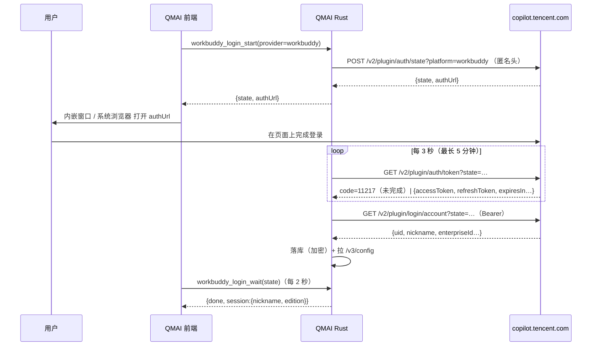

# WorkBuddy 账号登录（Agent 方式的第 4 种来源）—— 设计方案

> 目标：在「模型设置」里加一条**账号登录**路径 —— 用户用自己的 WorkBuddy 账号登录一次，QMAI 就能直接用它名下的模型，不需要 API Key、不需要在本机装任何 CLI。
> 边界：**本期只做国内版**（`copilot.tencent.com`）。国际版（`workbuddy.ai`）留二期，但数据模型、目录结构、UI 结构在本期就按两版预留，二期只补常量与 UA，不返工。
> 不影响：现有四家 CLI（claude / codex / cursor / antigravity）、预制 API、自定义模型三条既有路径，一个字节都不改。

---

## 一、为什么是「本地网关」而不是「再加一个 transport」

QMAI 现在有两种接法：HTTP（预制 API / 自定义）和子进程（四家 CLI）。WorkBuddy 属于**第三种**：它是标准 OpenAI 协议的上游，但鉴权与请求头是它私有的 —— 必须在 Rust 侧拼一串客户端身份头、注入首条 system 消息、并在 401 时刷新 token。

若做成子进程式 transport，写作链路里现成的这些能力会全部失效：上下文超限自动裁剪重试、`max_tokens` 降级、网络重试阶梯、用量统计、工具调用增量解析。

所以：**在 qmai 进程内起一个极小的 axum 网关**，把 WorkBuddy 伪装成一个普通 OpenAI 供应商。

```
前端 (llm-client.ts, 一行不改)
   │  POST http://127.0.0.1:<随机端口>/v1/chat/completions   Bearer <本次启动生成的令牌>
   ▼
┌──────────────────────────────────────────────┐
│ workbuddy::gateway（进程内 axum）             │
│   /health  /v1/models  /v1/chat/completions  │
│   ├ 账号选择（本期单账号，按优先级取第一个可用）│
│   ├ 凭证检查：临期先刷新，401 再刷一次重试      │
│   ├ 拼 WorkBuddy 私有头 + 注入兜底 system      │
│   └ SSE 原样透传（上游本就是 OpenAI chat 帧）  │
└──────────────────┬───────────────────────────┘
                   │ POST https://copilot.tencent.com/v2/chat/completions
                   ▼
              WorkBuddy 上游
```

前端拿地址与令牌的方式照抄 `cursor-cli` 的既有做法（`ensureCursorProxyRunning` → `withCursorProxyEndpoint`）：`invoke("workbuddy_gateway_ensure")` 拿到 `{base_url, token}`，把 `customEndpoint` / `apiKey` 临时替换后再走原 HTTP 通路。**模型列表、连通性测试、聊天、中断全部复用现有代码。**

---

## 二、页面与交互

### 2.1 三栏（`llm-provider-section.tsx:90-110`）

```
我的模型设置
┌──────────────┐ ┌──────────────┐ ┌────────────────┐
│ ＋ 添加账号   │ │ ＋ 添加提供方 │ │ ＋ 添加自定义模型 │
└──────────────┘ └──────────────┘ └────────────────┘

我的模型配置
┌ WorkBuddy 国内版   [已登录 2]  ▾   ← 登录成功后自动生成
┌ 其它已有配置…
```

- 沿用现有 `.model-add-row` / `.model-add-card`，两栏改三栏，位置从列表下方移到「我的模型设置」标题下方。
- 「添加账号」→ 先弹**来源列表**（本期只有 WorkBuddy 一项，带「N 个账号」计数）→ 点进去才是登录对话框。结构预留第二家。
- 账号登录成功后自动在「我的模型配置」生成卡片并启用；删掉**最后一个**账号时把该卡片 `enabled` 置 false（模型不再出现在选择器），卡片本身保留，重新登录后自动恢复启用。

### 2.2 「登录 / 添加 WorkBuddy 账号」对话框

```
登录 / 添加 WorkBuddy 账号                                    ✕
────────────────────────────────────────────────────────────
账号版本   [ 国内版（WorkBuddy） ]  [ 国际版（WorkBuddy AI）· 二期 ]
           两版可同时保存，各自一份模型清单。

添加方式   [ 网页登录 ]  [ 导入凭证文件 ]
────────────────────────────────────────────────────────────
网页登录
  打开方式   [ 内嵌窗口 ]  [ 系统默认浏览器 ]
  完成登录后自动加入账号列表，昵称取自上游。
  [ 打开网页登录 ]   内嵌窗口打开；完成后自动加入，关窗即取消等待
────────────────────────────────────────────────────────────
已有账号
  昵称 · uid 尾号 · 有效期至 …    [ 刷新 ]  [ 删除 ]
```

- 「国际版」分段本期**可见但禁用**，后缀「二期」—— 结构一次到位，二期只需放开。
- 「恢复 Google / GitHub 入口」开关本期**不出现**（只对国际版 + 内嵌窗口有意义），二期随国际版加。
- 「已有账号」一栏是 QMAI 自己加的：Agent2API 有独立账号页，QMAI 没有，把最常用的两个动作（刷新 / 删除）收进对话框。
- 关闭窗口 / 点「取消等待」= 取消这次登录（后端置 canceled，上游那轮 state 作废）。

### 2.3 视觉

沿用设置页现有卡片、字段、按钮样式（`model-settings.css`、`components/ui/*`）。分段控件 QMAI 没有现成组件，新增一个 60 行左右的 `SegmentedControl`（样式对齐现有 tab 与 `model-add-card` 的圆角/描边），供「账号版本 / 添加方式 / 打开方式」三处复用。

---

## 三、数据模型与存储

账号文件：`<app_config_dir>/workbuddy-accounts.json`，凭证字段加密。

```jsonc
{
  "version": 1,
  "accounts": [
    {
      "id": "user-<uid>",
      "provider": "workbuddy",            // 二期会有 workbuddy-intl
      "uid": "5877cabc-…",
      "nickname": "某某",
      "edition": "cn",
      "endpoint": "https://copilot.tencent.com",
      "prefixPath": "/plugin",
      "platform": "workbuddy",
      "auth": {                            // ← 整个 auth 对象加密成 "enc1:…"
        "accessToken": "…",
        "refreshToken": "…",
        "expiresAt": 1730000000000,
        "refreshExpiresAt": 1732600000000,
        "domain": "www.workbuddy.cn"
      },
      "addedAt": 1730000000000,
      "priority": 100,                     // 全局一条队列，本期单账号也照存
      "enabled": true
    }
  ]
}
```

- 加密：AES-256-GCM，信封 `enc1:<base64(nonce‖密文+tag)>`，密钥文件 `workbuddy-accounts.key` 与数据文件分离（拷走 json 打不开）。与 Agent2API 同一信封格式，便于互导。
- **前端永远拿不到 token**：IPC 只返回 `{id, provider, nickname, uidTail, expiresAt, enabled}`。
- 与 `app-state.json` 分开存：那里是明文，账号不能混进去。
- **同 uid 重复登录 = 覆盖更新**（换 token、刷新有效期），不新增记录；`id` 由 `user-<uid>` 派生，天然幂等。
- **Rust 只管账号文件**，不碰 `app-state.json`；模型卡片（`providerConfigs["workbuddy"]`）由前端在登录成功后写入，沿用现有 `saveProviderConfigs` 通道。

### 新增依赖

| crate | 用途 |
|---|---|
| `axum = "0.8"` | 本地网关三路由 |
| `aes-gcm = "0.10"` + `rand`（或 `getrandom`） | 凭证加密与 nonce |
| `tokio` 增 `net`、`time` 特性 | 监听端口、轮询计时 |
| `reqwest` 增 `stream` 特性 | SSE 逐块透传（现为 `blocking/json/rustls-tls`） |

### 与现有 provider 体系的对应

| QMAI 概念 | 值 |
|---|---|
| preset id / providerConfigs 键 | `workbuddy`（二期 `workbuddy-intl`） |
| `LlmConfig.provider` | `"workbuddy"` |
| `customEndpoint` | 运行时替换为网关 `http://127.0.0.1:<port>/v1` |
| `apiKey` | 运行时替换为网关令牌（内存态，不落盘） |
| `savedModels` | 登录后从 `/v3/config` 拉取，默认勾选 `isDefault` 的模型（最多 3 个） |
| `maxContextSize` | 取已选模型 `maxInputTokens` 的最小值（保守），用户可改大 |
| `maxOutputTokens` | 取默认模型的 `maxOutputTokens` |

模型 id 原样透传（WorkBuddy 的 id 本身就是全局唯一），不加前缀 —— 本期只有一家，二期引进 `workbuddy-intl` 时靠 provider 维度区分，不需要改写 id。

---

## 四、三条添加链路

### 4.1 网页登录（主路径）

WorkBuddy 是**轮询型**登录：没有本机回调，谁打开浏览器都无所谓。这正是它同时支持「内嵌窗口」和「系统默认浏览器」的原因。



**内嵌窗口**（`src-tauri/src/workbuddy/login_window.rs`）：

| 项 | 取值 |
|---|---|
| 构建 | `WebviewWindowBuilder::new(app, label, WebviewUrl::External(authUrl))` |
| label | `login-<state 的 sha256 前 16 位>` |
| 尺寸 | 1100×820，最小 760×560，居中 |
| 标题 | `登录 WorkBuddy 国内版账号` |
| 数据目录 | **每次登录新建临时目录**（登录结束删除）。复用默认目录会导致「添加第二个账号时直接以上一个账号身份进去」 |
| 隐私模式 | **不开**（`incognito(true)` 会让 Google/GitHub 判为不支持的浏览器；独立数据目录已提供隔离） |
| UA | **不改**。WebView2 原生 Edge UA 就是普通浏览器形态；自拼 UA 反而与 `Sec-CH-UA` 不一致，更显眼 |
| 导航白名单 | `copilot.tencent.com` / `*.tencent.com` / `workbuddy.cn` / `*.workbuddy.cn` / `codebuddy.cn` / `*.codebuddy.cn` / `staging-copilot.tencent.com`；`about:`、`data:` 放行；其余协议一律拦 |
| 新窗口 | 一律 `Deny`（本期没有需要弹窗的登录步骤） |
| 关闭 | `CloseRequested` → 通知后端取消 + 清状态 |

**系统浏览器**：同一份 `authUrl` 交给 `tauri-plugin-opener`，后端照旧轮询。两种打开方式的收敛点只有一个 —— `workbuddy_login_wait`。

**取消语义**：前端 `workbuddy_login_cancel(state)`；后端置 `canceled` 标记，轮询循环下一拍退出；同一个 state 再次 wait 返回 `{done:false, canceled:true}`。

### 4.2 导入凭证文件

前端读文本（`<input type=file accept=".info,.json">`），把**原始文本**交给后端解析。支持两种形态：

```jsonc
// ① 官方客户端登录态（嵌套形）
{ "auth": { "accessToken": "…", "refreshToken": "…", "expiresAt": 1730000000000, "domain": "www.workbuddy.cn" },
  "account": { "uid": "…", "nickname": "…" } }

// ② 扁平形（第三方导出）
{ "accessToken": "…", "uid": "…", "refreshToken": "…", "domain": "…" }
```

规则：
- 缺 `accessToken` 或 `uid` → 明确报错，指出缺哪个字段；
- 版本归属按 `auth.domain`（或顶层 `domain`）判断：`workbuddy.ai` → 国际版（本期提示「国际版二期支持」），`workbuddy.cn` / `codebuddy.cn` → 国内版；判断不出时用当前所选版本；
- 文件里的版本与当前所选不一致 → 按文件为准并 toast 提示，不静默；
- 只读文本，不解密、不联网。

### 4.3 导入桌面端登录态 —— **已删除（2026-10-27）**

原设计：不弹文件选择，后端按固定路径读
`%LOCALAPPDATA%\CodeBuddyExtension\Data\Public\auth\workbuddy-desktop.info`
（macOS 为 `~/Library/Application Support/CodeBuddyExtension/…`），当前文件缺失时退回
时间戳最大的备份。

**删除原因（实机验证）**：新版 WorkBuddy 客户端已把 `account.nickname`、
`auth.accessToken`、`auth.refreshToken` 全部改写成

```json
{ "$wbEncrypted": 1, "envelope": "base64({suite:1,keyId,nonce,authTag,ciphertext})" }
```

- 算法：`AES-256-GCM`；`keyId` = `sha256(sha256(atRestSecretKey))` 前 16 位十六进制
  （见安装包 `app.asar` → `/main/dist.js` 的 `deriveAtRestKeyId` / `normalizeAtRestKeyPayload`）；
- 密钥来源：客户端原生模块 `electron.workbuddyStorage`（`/main/credential-protection.js`），
  `atRestSecretKey` **不落盘、不可导出**，也不在 Chromium `Local State` 的 `os_crypt` 里；
- 结论：任何外部程序都读不出明文 —— 这条路对当前客户端**结构性不可用**。

因此整条链路（定位文件 / 读文件 / 只读探测 / 两个 Tauri 命令 / 对话框分段）已删除，
不在界面上留一个永远点不通的入口。用户想用客户端里那个账号 → 走「网页登录」。

「导入凭证文件」保留：它读的是用户**手动选择**的文件，旧版客户端的明文 `.info`
或第三方导出的 JSON 仍然可用；若选到加密的 `.info`，会明确提示改用网页登录
（`import::ENCRYPTED_CREDENTIAL`）。

---

## 五、请求链路（本地网关）

### 5.1 进程与端口

- 随应用启动（`lib.rs` 的 setup 里 `tokio::spawn`），`127.0.0.1:0` 取随机端口，**不占用 3065**（避免和用户自己装的 Agent2API 抢）。
- 绑定失败不 panic：`workbuddy_gateway_ensure` 会重试一次并返回可读错误；网关没起来时，模型列表与聊天都给「账号服务未就绪」，不影响其它 provider。
- 每次启动生成 32 字节随机令牌，只存在于内存与主窗口的 IPC 返回值里；`Authorization: Bearer <token>` 不匹配直接 401。
- 只暴露 `/health`、`/v1/models`、`/v1/chat/completions` 三条；关 CORS（QMAI 走 `plugin-http`，不需要）。
- 依赖：`axum = "0.8"`、`tokio` 增 `net`；`reqwest` 增 `stream` 特性（现为 `blocking/json/rustls-tls`）。

### 5.2 `/v1/models`

返回 `{object:"list", data:[{id, object:"model", owned_by:"workbuddy", name, max_input_tokens, max_output_tokens, supports_tool_call, supports_reasoning, is_default}]}`。
数据来自 `/v3/config` 的缓存；缓存为空时回落到内置清单（首次启动、刷新失败都不至于 0 个模型）。

### 5.3 `/v1/chat/completions`

1. 校验 `model` 在目录内（不在 → 400 `model_not_found`，与其它 provider 行为一致）；
2. 取账号（本期第一个 `enabled` 的；无账号 → 409，文案「还没有登录 WorkBuddy 账号」）；
3. `expiresAt - now < 5 分钟` 或上次 401 → 刷新（单飞，带 `X-Refresh-Token` + `X-Auth-Refresh-Source: plugin`）；
4. 改写请求：
   - **首条消息不是 `system` 就插一条**：`{"role":"system","content":"你是一个得力助手"}`。上游对非 system 开头直接 400。`developer` 角色先归一成 `system` 再判断；
   - 强制 `stream: true`（上游不支持非流式，`11101`）；
   - `max_tokens` 原样保留（QMAI 已经算好预算）。
5. 拼头：

```
Content-Type: application/json
User-Agent: WorkBuddy/5.5.4 WorkBuddy/5.5.4 CLI/2.137.1
X-IDE-Type / X-IDE-Name: WorkBuddy
X-IDE-Version: 5.5.4
X-Product: SaaS
X-Agent-Intent: craft   X-Agent-Purpose: conversation   X-Agent-Type: main
X-Private-Data: true
X-Conversation-ID / X-Conversation-Message-ID / X-Request-ID / X-Root-Request-ID / X-Conversation-Request-ID: 每轮新 uuid
X-Trace-ID / traceparent / b3 / X-B3-*: 同一 trace
Accept-Language: zh-CN
X-Requested-With: XMLHttpRequest
X-CodeBuddy-Request: 1
Origin / Referer: https://copilot.tencent.com
Authorization: Bearer <accessToken>
X-User-Id: <uid>
X-Domain: <auth.domain 或 copilot.tencent.com>
X-Enterprise-Id / X-Tenant-Id / X-Department-Info: 有才带
```

6. 发往 `{endpoint}/v2/chat/completions`，SSE 原样回流（用 `Body::from_stream` 透传字节，不做解析）。
7. 客户端若发 `stream:false`：网关内部仍以 `stream:true` 请求上游，收齐后聚合成一个标准 chat JSON 返回（QMAI 自己只用流式，但这条退路能让网关被 curl / 其它客户端直接调试）。

### 5.4 错误分类

| 上游 | QMAI 动作 |
|---|---|
| 401 / token 失效 | 刷新一次，同账号重试；再失败 → 提示重新登录 |
| 429 或业务码 `6004` | 不重试，返回「额度或并发受限」，文案建议换模型/稍后 |
| 业务码 `11-128` | 敏感词/风控：原样透传上游文案 + 一句排查提示，不换账号（本期只有一个） |
| 400 model 不存在 | 刷新一次模型目录后重试一次，仍失败 → 让用户在模型卡片里重新拉取 |
| 其它 4xx/5xx | 原样透传状态码与正文（截断到 500 字符） |

### 5.5 模型目录刷新时机

- 登录成功后立即拉一次；
- `/v1/models` 缓存为空时拉一次；
- 用户在卡片里点「刷新模型」；
- 不做定时刷新（本期只有一个 provider，够用；二期多 provider 再加）。

---

## 六、代码落点

### Rust（新增 `src-tauri/src/workbuddy/`）

| 文件 | 职责 | 预估行数 |
|---|---|---|
| `mod.rs` | 模块导出、命令注册入口 | 40 |
| `endpoints.rs` | 两版端点 / UA / platform / prefix，URL 拼装函数 | 150 |
| `accounts.rs` | 账号读写、加密信封、优先级、可用性 | 320 |
| `crypto.rs` | AES-256-GCM + `enc1:` 信封 + 密钥文件 | 140 |
| `login.rs` | state → 轮询 token → login/account → 落库，任务表与取消 | 300 |
| `login_window.rs` | 内嵌窗口、临时数据目录、导航白名单 | 220 |
| `import.rs` | 凭证文件解析（嵌套/扁平/判版本）+ 加密形态识别 | 150 |
| `refresh.rs` | `token/refresh`，单飞 + 401 重试 | 130 |
| `models.rs` | `/v3/config` 拉取、缓存、内置兜底、`/v1/models` 形状 | 300 |
| `chat.rs` | 头部集合、system 注入、错误分类 | 320 |
| `gateway.rs` | axum 三路由、端口、令牌、SSE 透传 | 260 |
| `commands.rs` | 对前端暴露的 10 个命令 | 180 |

命令清单：`workbuddy_login_start` / `_wait` / `_cancel`、`workbuddy_accounts_list` / `_remove` / `_refresh`、`workbuddy_import_file` / `_import_desktop`、`workbuddy_models_refresh`、`workbuddy_gateway_ensure`。

### 前端

| 文件 | 改动 |
|---|---|
| `src/components/settings/sections/llm-provider-section.tsx:90-110` | 两栏→三栏；挂「添加账号」对话框与账号卡片 |
| 新增 `src/components/settings/sections/add-workbuddy-account-dialog.tsx` | 对话框：版本 / 添加方式 / 三条子面板 / 已有账号 |
| 新增 `src/components/ui/segmented.tsx` | 分段控件（三处复用） |
| 新增 `src/lib/workbuddy-accounts.ts` | IPC 封装 + 账号列表缓存 + 登录状态机 |
| 新增 `src/lib/workbuddy-gateway.ts` | `ensureWorkbuddyGateway()`、`withWorkbuddyEndpoint()`（照 `cursor-cli-proxy.ts:107-136` 的形状） |
| `src/components/settings/llm-presets.ts:15-26` + 预设表 | `Provider` 加 `workbuddy`；加一条预设（`label: "WorkBuddy 国内版"`） |
| `src/stores/wiki-store.ts:236` | `LlmConfig.provider` 加 `"workbuddy"` |
| `src/components/settings/settings-types.ts:15,42` | 同步联合类型 |
| `src/lib/llm-providers.ts:1331-1561` | `getProviderConfig` 加 `workbuddy` 分支（chat_completions 线格式；`never` 检查会强制） |
| `src/lib/llm-client.ts:419-437` | 分派前 `ensureWorkbuddyGateway()`（cursor 同款） |
| `src/lib/settings-model-list.ts:113,240-281` | 模型列表走网关 `/v1/models` |
| `src/lib/has-usable-llm.ts:10-16,53-56` | 加 `workbuddy` 分支，口径与 CLI 同款：`isPresetAvailable(providerConfigs, "workbuddy")` 且有模型。登录态本身不进这个纯函数（它只看配置），删号时由前端把卡片 `enabled` 置 false |
| `src/components/settings/preset-resolver.ts:39-132` | `workbuddy` → `LlmConfig` 的映射分支 |

### 必须同步修改的测试

`src/lib/has-usable-llm.test.ts:17-30`、`src/components/settings/llm-wiki-model-settings.spec.ts:48-74`（精确的 preset id 数组）、`src/lib/llm-providers.spec.ts:759-782`、`src/lib/settings-model-list.spec.ts`。

---

## 七、风险与边界

| 风险 | 说明 | 处置 |
|---|---|---|
| **许可** | Agent2API 是 MIT + 附加声明（禁止商业用途 / 二次分发牟利），与 QMAI 的 GPL-3.0 存在冲突 | **只搬事实**（端点、头部名、字段、握手顺序），代码重写；README 注明参考来源。整段复制仅在确认非商业自用时才可接受 |
| **上游风控** | 以非官方客户端形态复用登录态，可能被限流或封号 | 首次使用弹一次明确提示；不默认开启；错误文案如实说明 |
| **凭证明文** | 官方客户端把 token 明文落在 `CodeBuddyExtension\…\auth\` | QMAI 落库必须加密（AES-GCM + 独立密钥文件），不跟随明文 |
| **长上下文** | 写作动辄几十万 token，WorkBuddy 各模型窗口不同 | 卡片 `maxContextSize` 取所选模型最小值；超限走 QMAI 既有裁剪重试 |
| **单账号** | 本期不做多账号轮转 | 队列结构先按多账号设计（`priority`），本期只取第一个可用 |
| **协议变动** | 上游随时可能改字段 | 错误分类按「透传 + 可操作文案」处理，不猜；目录缓存 + 内置兜底保证不空白 |
| **macOS 未验证** | 路径与 DPAPI 无关（.info 是明文 JSON），但未实测 | 逻辑与平台无关，仅路径不同；CI 不覆盖，标注「未实测」 |

---

## 八、验收标准

1. 设置 → 模型设置 → 大语言：看到三栏，点击「添加账号」出现 WorkBuddy，再点进入对话框；
2. 选国内版 → 网页登录 → 内嵌窗口打开腾讯登录页，登录成功后 5 秒内：对话框显示新账号、列表出现「WorkBuddy 国内版」卡片、卡片里已勾选默认模型；
3. 关掉内嵌窗口 → 对话框回到可再次发起的状态，且没有残留账号；
4. 再登录一次同一账号 → 提示已存在，不产生重复记录；
5. 用「导入凭证文件」导入含 accessToken + uid 的 JSON → 账号出现；导入非法 JSON / 缺 uid / 加密 `.info` → 明确报错；
6. 在 AI 对话里选 WorkBuddy 模型 → 正常流式出字；中途点停止 → 立即中断、不泄漏连接；
7. 手动把 `accessToken` 改成过期值 → 下一次请求自动刷新并成功（日志能看到一次 refresh）；
8. 断开网络 → 错误文案可读，不出现英文堆栈；
9. 删掉账号 → 卡片置灰、模型不出现在选择器里；重新登录后恢复；
10. `npm run test:mocks` 与 `npm run typecheck` 全绿；Rust 侧单测覆盖：信封加解密、凭证解析（嵌套/扁平/缺字段/加密形态）、system 注入、错误分类。

---

## 九、二期（国际版）预留

本期代码里凡是「版本相关」的东西都收敛在 `endpoints.rs` 的 `Edition` 常量与 `accounts.rs` 的 `provider` 字段：

- 二期加 `workbuddy-intl`：端点 `https://www.workbuddy.ai`、`platform: workbuddy-ai`、UA `WorkBuddy/5.8.4 workbuddy-ai/5.8.4 CLI/2.161.0`；
- 二期加「恢复 Google / GitHub 入口」：`initialization_script_for_all_frames` 持续移除 `oneid-only-login-style`，并放行 `accounts.google.com` / `github.com` 等身份域名（两个开关必须同时生效，否则白屏）；
- 二期放开对话框里被禁用的「国际版」分段。
